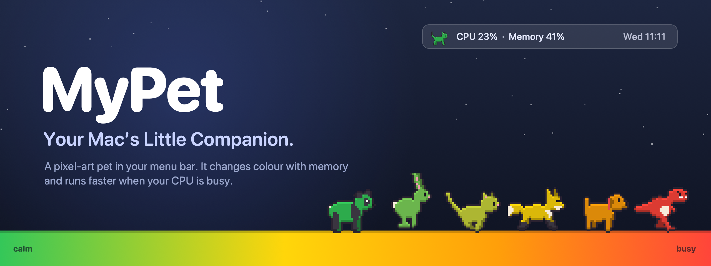
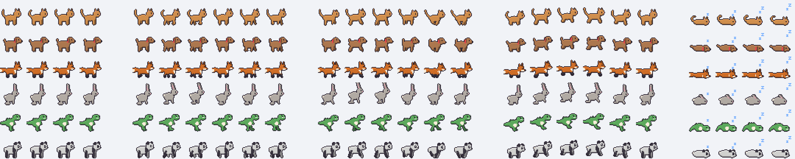

<p align="center">
  
</p>

<p align="center">
  <a href="https://github.com/eramitgupta/my-pet/releases"></a>
  <a href="https://github.com/eramitgupta/my-pet/actions/workflows/ci.yml"></a>
  
  
  <a href="LICENSE"></a>
</p>

<p align="center">
  <a href="https://github.com/eramitgupta/my-pet/releases"><b>Download</b></a> ·
  <a href="#how-to-read-your-pet">How to read your pet</a> ·
  <a href="#questions-people-ask">FAQ</a> ·
  <a href="https://github.com/sponsors/eramitgupta">❤️ Sponsor</a>
</p>

---

## Meet your new desk buddy

**MyPet** is a tiny pixel-art animal that lives in your Mac's menu bar, right next to the
clock. It's cute, but it's also quietly useful: one glance tells you how your Mac is doing.

- When your Mac has plenty of free memory, your pet is **green**. As memory fills up, it turns
  **yellow, then orange, then red**.
- When your Mac is relaxed, your pet takes it easy and **strolls**. When something is working
  the CPU hard, it **sprints**.

You don't need to open Activity Monitor to notice that something is hogging your Mac. Your pet
will tell you.

<p align="center">
  
</p>

Pick from six friends: **cat, dog, fox, rabbit, dinosaur and panda**. Each one has its own
idle, walk, run, jump and sleep animations.

## How to read your pet

Your pet tells you two things at once:

- its **colour** shows how your Mac's **memory** is doing, and
- its **running speed** shows how busy the **CPU** is.

| Your pet looks… | It means… |
|---|---|
| 🟢 **Green** | Plenty of memory to spare. All good. |
| 🟡 **Yellow** | Memory is getting used. Still fine. |
| 🟠 **Orange** | Memory is quite full. A few heavy apps might be worth closing. |
| 🔴 **Red** | Your Mac is short on memory and may start to feel slow. |
| 🐾 **Strolling** | CPU is mostly idle. |
| 🏃 **Running** | Normal work. |
| 💨 **Sprinting** | Something is keeping the CPU busy. |
| 😴 **Sleeping** | You paused it. Click the pet → *Pause* to wake it up. |

Colours blend smoothly, so you'll see a gentle fade from one colour to the next rather than a
flicker. You can pick your own colours and decide where each one starts in **Settings →
Appearance**.

### What makes your pet run faster or slower?

The speed comes from your Mac's **CPU usage**, the same "% CPU" Activity Monitor shows for the
whole Mac.

1. Every 1.5 seconds MyPet checks how busy the CPU is across all cores.
2. The reading is smoothed a little, so a one-second spike doesn't send your pet into a sprint.
3. That number picks the pace:

| CPU usage | Your pet | Speed | Frames per second |
|---|---|---|---|
| Under 25 % | 🐾 strolls | 0.6× | about 7 |
| 25 – 65 % | 🏃 runs | 1.0× | 12 |
| Over 65 % | 💨 sprints | 1.8× | about 22 |

Around 25 % and 65 % the speed changes gradually rather than jumping. Click the pet to see the
live CPU number and its pace ("Pet strolls", "Pet trots" or "Pet sprints").

Prefer a steady pace? Go to **Settings → Behaviour**, turn off *Speed follows CPU usage*, and
choose any speed from 0.25× to 3×.

To save energy, your pet also slows down or stops on its own:

| When… | Your pet… |
|---|---|
| your Mac is on battery (with *Battery saver* on) | runs at most 8 frames per second |
| Low Power Mode is on | runs at most 5 frames per second |
| you pause it, the Mac sleeps, the screen locks, or a full-screen app hides the menu bar | stops completely until it's visible again |

In short, **speed = CPU**, **colour = memory** (RAM usage or memory pressure, your choice), and
**direction = your Flip setting**. The exact formulas are in [docs/METRICS.md](docs/METRICS.md).

## Things you can do

- **Click the pet** to see live CPU and memory numbers, pause it, or flip it around.
- **Choose a pet** from the gallery and watch a live preview before you commit.
- **Flip it.** Make it face left or right, or let it turn around by itself now and then.
- **Pick what the colour tracks:** *RAM usage* (how full memory is) or *memory pressure* (how
  hard macOS is working to find memory). See [the FAQ](#questions-people-ask) for the difference.
- **Set the speed:** let the CPU decide, or set a fixed speed you like.
- **Launch at login**, so your pet is there every morning.
- **Add your own pets.** Drop a folder of sprites in and it shows up in the gallery
  ([how](#make-your-own-pet)).

## Install

1. Download the latest **`MyPet-x.y.z.dmg`** from
   [Releases](https://github.com/eramitgupta/my-pet/releases).
2. Open it and drag **MyPet** into **Applications**.
3. Open MyPet. Your pet appears in the menu bar. That's it!

> **First launch says it can't be opened?** Community builds may not be notarised by Apple
> yet. Right-click MyPet in Applications → **Open** → **Open**. You only need to do this
> once.

MyPet runs quietly in the menu bar and doesn't show a Dock icon. To open Settings, click the
pet → **Settings…**, or simply open MyPet again from Applications.

## Questions people ask

<details>
<summary><b>Will it drain my battery?</b></summary>

No. MyPet is built to be as light as possible:

- It uses **about 1 % CPU** while animating and **almost nothing when paused** (measured on an
  Apple M2), with roughly **20 MB** of memory.
- It **stops animating whenever you can't see it**: when your Mac sleeps, when the screen is
  locked or off, and when a full-screen app hides the menu bar.
- On battery it **slows its animation down**, and in **Low Power Mode** even more.
- It never keeps your Mac awake.

The full measurements are in [docs/PERFORMANCE.md](docs/PERFORMANCE.md).
</details>

<details>
<summary><b>What's the difference between "RAM usage" and "memory pressure"?</b></summary>

- **RAM usage** is how *full* your memory is. It's the same "Memory Used" number Activity
  Monitor shows. macOS likes to keep memory full of useful caches, so a high number isn't
  automatically bad.
- **Memory pressure** is how *stressed* your Mac is about memory: whether it has to compress
  data or use the disk (swap) to keep up. It's the better signal for "is my Mac about to slow
  down?"

If your pet is often red but your Mac feels fine, try switching to *memory pressure*. The exact
formulas are in [docs/METRICS.md](docs/METRICS.md).
</details>

<details>
<summary><b>Does MyPet collect any data or go online?</b></summary>

MyPet has no accounts and no analytics. It reads your CPU and memory statistics through standard
macOS APIs and keeps its settings on your Mac. The only time it goes online is to **check for
updates**: it fetches a small file from GitHub once a day, or when you click *Check for
Updates…*. You can turn automatic checks off in **Settings → General**.
</details>

<details>
<summary><b>How do updates work?</b></summary>

Click the pet → **Check for Updates…**. If there's a new version, you'll see what's new and can
install it with one click. MyPet restarts on the new version with your settings and pets just
as you left them. Every update is digitally signed, and MyPet refuses anything that isn't from
the real project. By default it also checks quietly once a day.
</details>

<details>
<summary><b>Which Macs does it work on?</b></summary>

Any Mac running **macOS 13 Ventura or later**, both Apple Silicon and Intel.
</details>

<details>
<summary><b>I turned on "Launch at login" but it asks for approval.</b></summary>

macOS sometimes asks you to confirm. Open **System Settings → General → Login Items** and allow
MyPet. It works best when MyPet is in your Applications folder.
</details>

<details>
<summary><b>My pet disappeared from the menu bar.</b></summary>

On MacBooks with a notch, a crowded menu bar can hide icons behind the notch. Try quitting a
few other menu-bar apps, or use a menu-bar organiser.
</details>

## Make your own pet

Every pet is just a folder with a small `manifest.json` and five sprite strips (idle, walk,
run, jump, sleep). Put the folder in `~/Library/Application Support/MyPet/Pets/` and restart
MyPet. Your pet shows up in the gallery, with no coding needed.

<details>
<summary><b>Pet folder format</b></summary>

```
owl/
├── manifest.json
├── idle.png  walk.png  run.png  jump.png  sleep.png      # horizontal strips, one frame per cell
└── idle_mask.png … sleep_mask.png                        # optional: white = recolour, black = keep
```

```json
{
  "id": "owl", "displayName": "Owl", "frameSize": [32, 32], "baseColor": "#B08A5A",
  "menuBarAnimation": "run",
  "animations": {
    "idle":  { "frames": 4, "fps": 4,  "loop": true },
    "walk":  { "frames": 6, "fps": 8,  "loop": true },
    "run":   { "frames": 6, "fps": 12, "loop": true },
    "jump":  { "frames": 6, "fps": 10, "loop": false },
    "sleep": { "frames": 4, "fps": 2,  "loop": true }
  }
}
```

Tips:

- Draw the parts that should change colour in **neutral greys**; MyPet tints them. Keep
  outlines, eyes and other details in their real colours, and black in the mask.
- `baseColor` is the pet's natural colour, used when colour tracking is turned off.
- If a pet doesn't show up, its folder has a problem. Run
  `log stream --predicate 'subsystem == "com.erag.mypet"'` and restart MyPet to see why.

Want it bundled with the app for everyone? Open a pull request, or suggest it with the
[new pet template](https://github.com/eramitgupta/my-pet/issues/new?template=new_pet.yml).
</details>

## For developers

MyPet is a native app with no Electron and no web views. A small **Rust** engine measures your
Mac and works out the pet's colour and pace. **SwiftUI** draws the settings, and **AppKit** with
**Core Animation** draws the pet in the menu bar. The only third-party dependency is
[Sparkle](https://sparkle-project.org), the standard framework for safe, signed app updates
(see [docs/UPDATES.md](docs/UPDATES.md)).

```bash
rustup target add aarch64-apple-darwin x86_64-apple-darwin   # once
scripts/build-app.sh release                                 # → build/MyPet.app
open build/MyPet.app
```

You only need the Xcode Command Line Tools and [Rust](https://rustup.rs). Full Xcode is
optional. No Apple account is needed to build and run.

<details>
<summary><b>More commands</b></summary>

| Command | What it does |
|---|---|
| `cargo test` | run the Rust engine tests |
| `scripts/build-app.sh debug` | faster build for your Mac only |
| `scripts/make-dmg.sh` | package `build/MyPet-<version>.dmg` |
| `open macos/mypet.xcodeproj` | work in Xcode (⌘R to run, ⌘U for tests) |
| `cd macos && xcodegen generate` | regenerate the Xcode project after adding files |
| `swift scripts/generate-sprites.swift --preview docs/pets-preview.png` | redraw the built-in pets |
| `swift scripts/generate-banner.swift` | redraw this README's banner |
| `swift scripts/generate-icon.swift` | redraw the app icon |
| `scripts/test-updates.sh` | end-to-end update test with the real Sparkle framework (offline) |
</details>

<details>
<summary><b>Releases, signing and updates</b></summary>

Push a tag like `v0.2.0` (matching `Cargo.toml`, `macos/project.yml` and a `## [0.2.0]` section
in `CHANGELOG.md`). GitHub Actions then builds, signs, notarises and publishes the release, and
adds it to the signed Sparkle appcast on GitHub Pages so installed copies update themselves.
The one-time setup (update signing key, Developer ID and GitHub secrets, Pages) is in
[docs/UPDATES.md](docs/UPDATES.md).
</details>

The design and the rules for contributors are in [GUIDELINES.md](GUIDELINES.md). If you use an
AI coding assistant, it will find its instructions in [AGENTS.md](AGENTS.md).

## Contributing

Ideas, bug reports, new pets and pull requests are all very welcome.

- Found a bug or have an idea? [Open an issue](https://github.com/eramitgupta/my-pet/issues/new/choose).
- Want to help with code? Start with [CONTRIBUTING.md](CONTRIBUTING.md).
- Please be kind. See our [Code of Conduct](CODE_OF_CONDUCT.md).
- Found a security problem? Please report it privately; see [SECURITY.md](SECURITY.md).

## Support the project

MyPet is free and open source. If it makes your day a little brighter, you can
[sponsor its development on GitHub ❤️](https://github.com/sponsors/eramitgupta). Starring the
repo helps too!

## License

Made with care by [@eramitgupta](https://github.com/eramitgupta).
Released under the [MIT License](LICENSE) © 2026 eramitgupta.
